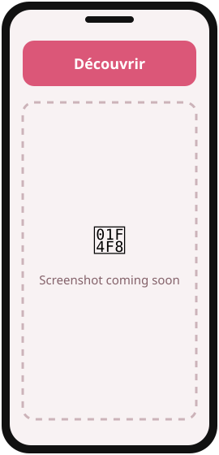
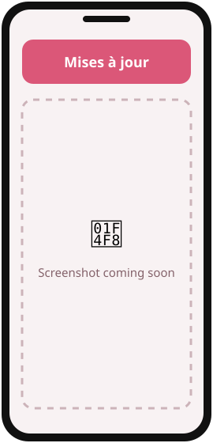
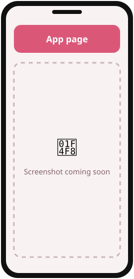

<div align="center">


# iurikaFlows

**A tiny open-source app store that installs and auto-updates all my Android apps.**

   

[](https://github.com/Iurika-N-T-R/iurikaFlows/releases/latest)
[](https://github.com/Iurika-N-T-R/iurikaFlows/releases)
[](LICENSE)
[](https://github.com/Iurika-N-T-R/iurikaFlows/stargazers)

[**⬇️ Download**](#download) · [**📸 Screenshots**](#screenshots) · [**✨ Features**](#features) · [**🛠️ Build**](#build)

</div>

---

<a id="screenshots"></a>

## 📸 Screenshots

<!-- TODO: replace docs/assets/screenshot-N.svg with real screenshots (same size for all, e.g. 1080x2400) -->
<div align="center">
<table>
  <tr>
    <td align="center"><br><sub><b>Découvrir</b></sub></td>
    <td align="center"><br><sub><b>Mises à jour</b></sub></td>
    <td align="center"><br><sub><b>App page</b></sub></td>
  </tr>
</table>
</div>

---

## 💡 What is iurikaFlows?

iurikaFlows helps **people who use my apps** install them and **keep them up to date automatically**,
without the Play Store and without checking GitHub by hand. It lists every open-source app published on
[github.com/Iurika-N-T-R](https://github.com/Iurika-N-T-R), installs it, and updates it silently in the background.
It is free, open source, has zero dependencies and contains no ads or trackers.

### 👥 Who is it for?

- 📲 **Users of DroRef, OnlyFlows, ColorFlows, galleryFlows, vidéoFlows, RandomFlows…** who want updates without effort
- 🛠️ **Developers** curious about a minimal GitHub-Releases app store (PackageInstaller + JobScheduler, no libraries)

---

<a id="features"></a>

## ✨ Features

| | Feature | Description |
|:-:|---|---|
| 🛍️ | **Découvrir** | Every app, grouped by category, with Install / Update / Open |
| 🔄 | **Auto updates** | Silent background updates (Android 12+), Wi-Fi only option, every 1 h / 6 h / 24 h |
| 📰 | **Release notes** | What's new and full changelog for every app |
| 📦 | **Installed apps** | What you installed from the store, per-app auto-update switch, uninstall |
| 🧪 | **Pre-releases** | Opt in to test versions |
| 🔑 | **GitHub token** | Optional, lifts the 60 requests/hour API limit |
| ⭐ | **Followed repos** | Add other accounts' repos with an APK in their releases |
| 📡 | **LAN sync** | Token and followed repos shared between your devices on the same Wi-Fi, paired with a 6-digit code |
| 🔒 | **Private by design** | Talks only to the GitHub API and your own paired devices — no account, no tracking |

<details>
<summary><b>📖 How it works</b></summary>

- Each public, non-fork repo of [Iurika-N-T-R](https://github.com/Iurika-N-T-R) whose latest GitHub release has an `.apk` asset appears in the store
- **Découvrir**: search your apps, Install / Update / Open from the list; a banner when iurikaFlows itself has a new version
- **Mises à jour**: pending updates with their release notes, "update all", last check time and a manual check; apps already up to date
- **Installées**: apps installed from the store
- **Réglages**: auto-update of the store and of the apps, Wi-Fi only, pre-releases, check every 1 h / 6 h / 24 h, optional GitHub token, followed repos list, LAN sync (show a code on one device, type it on the other)
- **App page**: version, size, installed version, release count, Install / Update / Open with a progress bar, what's new and full changelog, description, repo and releases links, per-app auto-update switch, uninstall
- Apps installed through iurikaFlows update silently in the background (Android 12+); iurikaFlows updates itself the same way

**Publishing an app to the store:** create a GitHub release on the repo with the APK attached. Tags like `v1.2.3` or `V1.2.3`
are compared with the installed `versionName`. Categories on *Découvrir* come from the repo's GitHub topics
(e.g. `digital-art`, `productivity`, `randomizer`); without a matching topic an app lands in "Autres".

</details>

---

<a id="download"></a>

## ⬇️ Download

<div align="center">

<a href="https://github.com/Iurika-N-T-R/iurikaFlows/releases/latest">
  
</a>

</div>

### 📦 Install the APK

1. Go to the [**latest release**](https://github.com/Iurika-N-T-R/iurikaFlows/releases/latest).
2. Under **Assets**, download the file ending in **`.apk`**.
3. Open it on your phone. If Android asks, allow **"Install unknown apps"** for your browser/file manager.
4. Tap **Install**. Done! 🎉

<details>
<summary><b>❓ Why isn't it on the Play Store?</b></summary>
<br>
iurikaFlows is an independent, free project. Instead of the Play Store, it is distributed through
GitHub Releases.
The APKs are built from this public source code — you can check everything.
</details>

<details>
<summary><b>🛡️ Is it safe? Android says "unknown source"</b></summary>
<br>
This warning appears for every app installed outside the Play Store. The code is 100% public in this repository,
and each release is signed with the same key, so Android will refuse any modified version.
</details>

> **Requirements:** Android 7.0+ (silent updates on Android 12+) · ~0.6 MB

---

<a id="build"></a>

## 🛠️ Build from source

<details>
<summary><b>For developers — click to expand</b></summary>

**Prerequisites:** [Android Studio](https://developer.android.com/studio) (latest) or the Android SDK (platform 36) · JDK 17–21

```bash
git clone https://github.com/Iurika-N-T-R/iurikaFlows.git
cd iurikaFlows
./gradlew assembleDebug
```

The APK is generated in `app/build/outputs/apk/debug/`.

**Signed release:** `./gradlew assembleRelease` signs the APK only if a git-ignored `keystore.properties`
(`storeFile`, `storePassword`, `keyAlias`, `keyPassword`) sits at the project root; otherwise it comes out unsigned.

</details>

---

## 🤝 Contributing

Ideas, bugs, translations — all contributions are welcome!

- 🐛 **Found a bug?** → [Open an issue](https://github.com/Iurika-N-T-R/iurikaFlows/issues/new)
- 💡 **Have an idea?** → [Open an issue](https://github.com/Iurika-N-T-R/iurikaFlows/issues) and describe it
- ⭐ **Like it?** → A star on this repo helps other people find it!
- ☕ **Want to support the work?** → [Buy me a coffee](https://buymeacoffee.com/iurika)

---

## 🧩 More apps by Iurika-N-T-R

<!-- Same block in EVERY repo: cross-linking boosts visibility of all the projects -->
| App | Description |
|---|---|
| [**DroRef**](https://github.com/Iurika-N-T-R/DroRef) | Reference board for artists, opens and saves PureRef `.pur` files |
| [**OnlyFlows**](https://github.com/Iurika-N-T-R/OnlyFlows) | Offline-first task & project manager with LAN sync |
| [**ColorFlows**](https://github.com/Iurika-N-T-R/ColorFlows) | Color harmonies, palettes from pictures, painter's shading sphere |
| [**galleryFlows**](https://github.com/Iurika-N-T-R/galleryFlows) | Gallery that browses your real folder tree |
| [**vidéoFlows**](https://github.com/Iurika-N-T-R/videoFlows) | Your own videos in a vertical swipe feed |
| [**RandomFlows**](https://github.com/Iurika-N-T-R/RandomFlows) | Randomizer & decision maker on your own lists |
| [**Brush Converter**](https://github.com/Iurika-N-T-R/ABR-to-PRZP-Brush-converter) | Photoshop `.abr` brushes → Infinite Painter `.przp`, in the browser |

---

<div align="center">

📄 Released under the **[MIT License](LICENSE)**

Made with ❤️ by [**Iurika-N-T-R**](https://github.com/Iurika-N-T-R)

<sub>If iurikaFlows is useful to you, consider giving it a ⭐ — it really helps!</sub>

</div>
